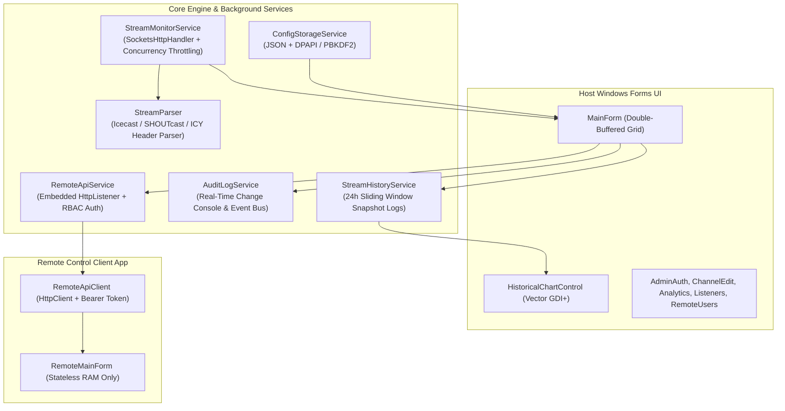
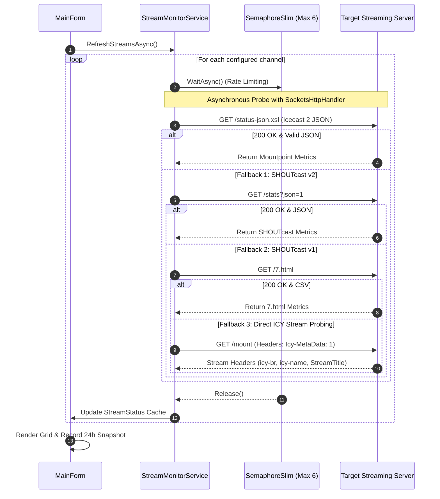
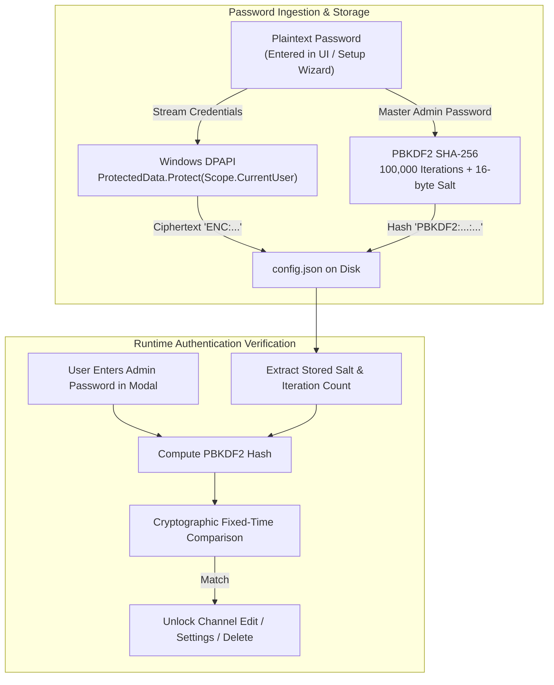

# 🏛️ Technical Architecture & System Design

This document details the internal design, concurrency model, data flow, cryptographic security, and network protocol pipelines of **Icecast & SHOUTcast Live Stream Monitor Suite**.

---

## 1. High-Level Component Diagram

---

## 2. Multi-Protocol Probing Lifecycle

When the periodic timer triggers or a manual refresh is requested, `StreamMonitorService` initiates asynchronous HTTP probes with strict concurrency management:

---

## 3. Security & Cryptography Architecture

---

## 4. Role-Based Access Control (RBAC) & API Specifications

The host application runs an embedded lightweight HTTP server on port `8080` (`RemoteApiService`). All endpoints except `/api/auth/login` require a valid session bearer token.

### API Endpoints:

| Endpoint | Method | Required Permission | Description |
| :--- | :--- | :--- | :--- |
| `/api/auth/login` | `POST` | *Public* | Authenticates username/password; returns JWT session token and user permission flags. |
| `/api/streams` | `GET` | `CanViewStatus` | Returns real-time status of all channels (online, listeners, bitrate, format, song title). |
| `/api/streams/{id}/history` | `GET` | `CanViewLogs` | Returns 24-hour snapshot logs and summary metrics for charting. |
| `/api/streams/{id}/listeners` | `GET` | `CanViewListenerIps` | Returns live connected client IP addresses and user-agents (**Restricted for normal viewers**). |
| `/api/streams/refresh` | `POST` | `CanRefreshStreams` | Triggers an immediate refresh cycle across all channels. |
| `/api/streams/manage` | `POST` | `CanManageChannels` | Adds or deletes a channel on the server (**SuperAdmin only**). |
| `/api/audit` | `GET` | `CanViewAuditLogs` | Returns configuration change audit logs. |

---

## 5. Historical Chart Vector Rendering Engine

The custom GDI+ control (`HistoricalChartControl`) renders high-DPI vector graphics directly into memory using hardware double-buffering:

- **Anti-Aliasing**: `SmoothingMode.AntiAlias` and `TextRenderingHint.ClearTypeGridFit`.
- **Area Fill**: Linear gradient brushes with alpha channel fading (`Color.FromArgb(60, Color)` to `Color.FromArgb(8, Color)`).
- **Crosshair Hover**: Calculates nearest geometric Euclidean distance on mouse hover and renders floating tooltip badges.
- **Auto-Scaling**: Dynamically computes 5-division Y-axis spans and time-spaced X-axis intervals.
