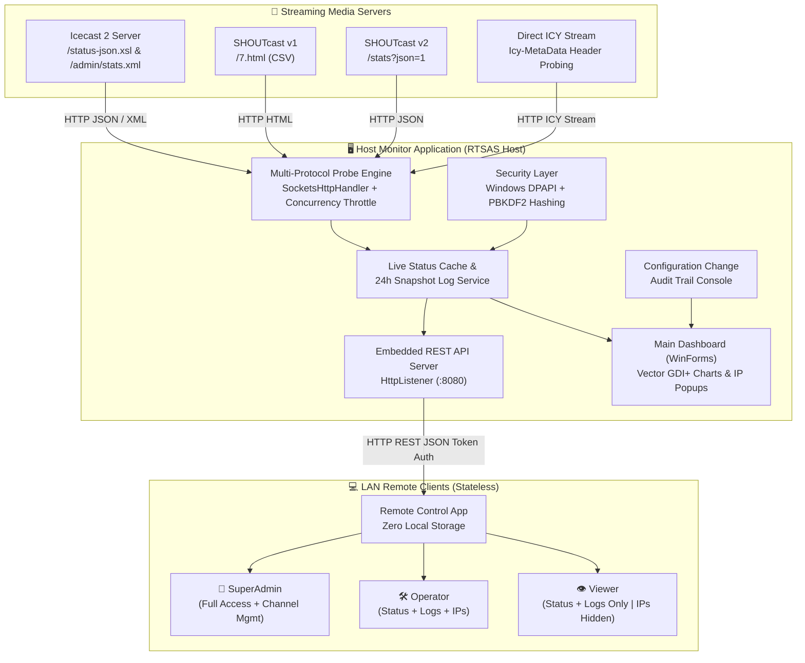
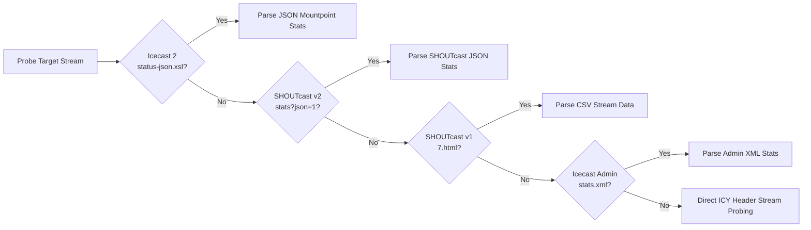

<p align="center">
  
</p>

<h1 align="center">RTSAS — RadioTEDU Stream Application Suite</h1>

<p align="center">
  <b>High-Performance Icecast & SHOUTcast Live Stream Monitor, Security & Remote Control Suite</b>
</p>

<p align="center">
  <a href="LICENSE"></a>
  
  
  
  
  
  
</p>

RTSAS is the streaming monitoring, management, and automation suite for the **RadioTEDU** and **RTAI** ecosystem. It is engineered to monitor live and automated audio streams across **Icecast 2** and **SHOUTcast (v1/v2)** servers, keep station and track metadata synchronized, inspect connected listener IPs, and provide a **stateless LAN Remote Control companion client** with role-based access control (RBAC).

---

## 🏗️ System Architecture & Data Flow



---

## ⚡ Key Highlights & Capabilities

- 🎯 **Lightweight & Blazing Fast**: Pure .NET Windows Forms with asynchronous non-blocking I/O (`SocketsHttpHandler`, `SemaphoreSlim`). Memory footprint **< 30 MB** with negligible CPU overhead.
- 📡 **Stateless Remote Control Companion App**: Manage and inspect streams from any computer across the local area network (LAN). Operates **statelessly in-memory** without caching or storing files on client machines.
- 👥 **Multi-User RBAC & Granular Permissions**: Define users with granular capability flags (`CanViewStatus`, `CanViewLogs`, `CanViewListenerIps`, `CanRefreshStreams`, `CanManageChannels`, `CanViewAuditLogs`). Restrict sensitive listener client IPs or channel modifications for normal viewers!
- 🔒 **Encrypted Password Security & PBKDF2 Hashing**: Passwords stored in `config.json` are encrypted at rest using **Windows DPAPI (`ProtectedData.Protect`)**. Master admin passwords are cryptographically salted and hashed using **PBKDF2 SHA-256 (100,000 iterations)**.
- 🛡️ **Per-Channel Security Verification**: Prompts for Master Admin authentication before editing or viewing credentials for each channel independently (no sticky bypasses).
- 👥 **Connected Listener Client IP Inspection**: Real-time popup displaying connected client IPs, location/network type, connected durations, and player user-agents (VLC, Chrome, Winamp, Foobar2000, AIMP).
- 📈 **24-Hour Live Analytics & Vector Charts**: Smooth anti-aliased GDI+ area charts for **Concurrent Listeners**, **Data Transfer & Bandwidth (MB/GB)**, and **Response Latency (Ping)** with crosshair hover tooltips and CSV export.
- 📋 **Configuration Audit Console**: Real-time audit trail tracking password alterations, mount changes, port updates, channel state toggles, and stream failure alerts.
- 📦 **Setup Wizard Installer**: Complete 4-step wizard that validates server inputs, configures initial mountpoints, and sets up desktop shortcuts.
- 🚀 **Automated GitHub Updates**: Built-in GitHub Releases checker with in-app changelog viewer and one-click updates.

---

## 📊 Protocol Compatibility Matrix



| Server Engine | Endpoint / Mechanism | Extracted Data |
| :--- | :--- | :--- |
| **Icecast 2 (JSON)** | `/status-json.xsl` | Listeners, Peak, Bitrate, Format, Title, Genre, Uptime |
| **Icecast 2 (Admin XML)** | `/admin/stats.xml` | Server metrics, connected listener IP list, user-agents |
| **SHOUTcast v2 (JSON)** | `/stats?json=1` | Listeners, Peak, Bitrate, Content-Type, Current Track |
| **SHOUTcast v1 (HTML/CSV)** | `/7.html` | Listeners, Server Status, Peak, Max, Bitrate, Song Title |
| **Direct ICY Probing** | `Icy-MetaData: 1` | `icy-br`, `icy-name`, `icy-genre`, `StreamTitle` chunk stream |

---

## 🚀 Installation & Getting Started

### Method 1: Windows Setup Installer Wizard (Recommended)
1. Download the latest **`IcecastStreamMonitor.Installer.exe`** from [GitHub Releases](https://github.com/radiotedu/rtsas/releases).
2. Run the installer wizard:
   - Select installation directory.
   - Enter your Server Host/IP, Admin Password, and Stream Password.
   - Click `+ Add Mount` to add your channels (e.g. `/live`, `/lofi`, `/rock`).
   - Select desktop shortcut preferences and click **Install**.

### Method 2: Build from Source (.NET 10 SDK)
```powershell
# Clone the repository
git clone https://github.com/radiotedu/rtsas.git
cd rtsas

# Run test suite (29 tests)
dotnet test IcecastStreamMonitor.slnx

# Run Host Application
dotnet run --project IcecastStreamMonitor/IcecastStreamMonitor.csproj

# Run Remote Client App
dotnet run --project IcecastStreamMonitor.RemoteControl/IcecastStreamMonitor.RemoteControl.csproj
```

---

## ⌨️ Keyboard Shortcuts

| Shortcut | Action |
| :--- | :--- |
| `Ctrl + N` | Add New Channel / Mountpoint |
| `Ctrl + E` / `Enter` | Edit Selected Channel (Prompts Admin Auth) |
| `Delete` | Remove Selected Channel |
| `Ctrl + D` | Duplicate Selected Channel |
| `Ctrl + T` / `Space` | Toggle Active / Disabled |
| `Ctrl + G` | Open 24-Hour Analytics & Charts Dialog |
| `Ctrl + L` | Open Connected Listener IPs Popup |
| `F5` | Refresh All Streams Immediately |
| `Ctrl + ,` | Open Global Settings & Tray Preferences |

---

## 📁 Repository Structure

```
rtsas/
├── assets/branding/                 # Official RadioTEDU, RTAI, and RTSAS Branding Logos
├── IcecastStreamMonitor/             # Core Host Monitor Application & REST API
│   ├── Controls/                     # GDI+ Vector Historical Chart Control
│   ├── Forms/                        # Main Dashboard, Channel Edit, Analytics, Listeners, Remote Users Dialogs
│   ├── Models/                       # AppSettings, StreamChannel, Listener, AuditLog, RemoteUser
│   └── Services/                     # Monitor, Probing, History, Audit, SecurityHelper, RemoteApiService
├── IcecastStreamMonitor.RemoteControl/# Zero-Storage Stateless LAN Companion Client App
│   ├── Controls/                     # Remote Vector Charts Control
│   ├── Forms/                        # Remote Login, Remote Dashboard, Analytics, Listeners Dialogs
│   ├── Models/                       # Remote Models & RBAC Permissions
│   └── Services/                     # RemoteApiClient (REST API Client)
├── IcecastStreamMonitor.Installer/   # Standalone Setup Installer Wizard
├── IcecastStreamMonitor.Tests/       # xUnit Automated Unit & Integration Tests (29 Passed)
├── .github/workflows/               # GitHub Actions CI/CD Release Pipeline
├── ARCHITECTURE.md                  # Comprehensive Technical Architecture & Design Document
├── CONTRIBUTING.md                  # Contribution Guidelines & Code Standards
├── SECURITY.md                      # Security Disclosure Policy & Cryptographic Specifications
├── LICENSE                          # MIT License
└── README.md                        # Project Documentation
```

---

## 🏷️ Branding

<p align="center">
  <br><br>
  
</p>

RTSAS uses the RadioTEDU broadcast-signal mark to identify it as part of the same open-source radio and AI tooling family.

---

## 📄 License

Licensed under the [MIT License](LICENSE).
