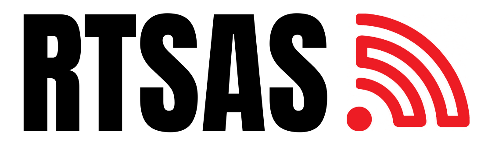
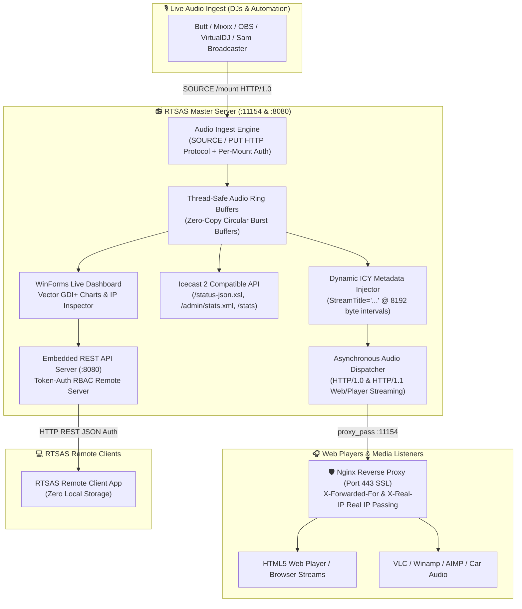
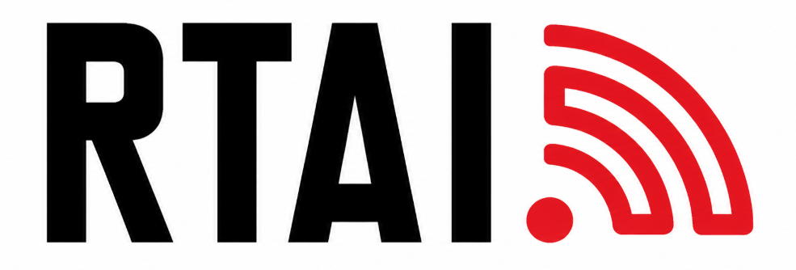

<p align="center">
  
</p>

<h1 align="center">RTSAS — RadioTEDU Stream Application Suite</h1>

<p align="center">
  <b>High-Performance Audio Streaming Media Server, Live Ingest Engine & Remote Management Station</b><br/>
  <i>Complete Standalone Alternative to Icecast, TinyIce, and RocketStream in pure C# (.NET 10)</i>
</p>

<p align="center">
  <a href="LICENSE"></a>
  
  
  
  
  
  
  
</p>

**RTSAS** is the high-performance audio streaming media server and station management suite for the **RadioTEDU** and **RTAI** ecosystem. It functions as a complete, lightweight, and modern **replacement for TinyIce and Icecast**, engineered to ingest live broadcast feeds from DJ software (Butt, Mixxx, OBS, VirtualDJ, Liquidsoap), broadcast live audio streams to thousands of web/media listeners, render 24-hour vector analytics, inspect real-time connected listener IPs, and provide a **stateless LAN/WAN Remote Control companion client** with role-based access control (RBAC).

---

## 🏗️ System Architecture & Data Flow



---

## ⚡ Key Capabilities & Features

### 📡 1. Standalone Broadcast & Ingest Engine (TinyIce / Icecast Alternative)
- **DJ Ingest Support**: Native support for `SOURCE /mount HTTP/1.0` and `PUT /mount HTTP/1.1` protocols from standard DJ software (**Butt, Mixxx, VirtualDJ, OBS, Sam Broadcaster, Liquidsoap**).
- **Per-Mount Password Authentication**: Authenticate DJ feeds against individual mountpoint passwords or global master source passwords.
- **Dynamic Audio Codec Support**: Transmits MP3, AAC, AAC+, Ogg Vorbis, Opus, and FLAC streams without transcoding latency.
- **Audio Burst Buffers (64 KB)**: Newly connected listeners immediately receive audio burst chunks to eliminate initial playback silence or buffering delay.
- **Dynamic ICY Metadata Injection**: Injects `StreamTitle='Artist - Song';` metadata frames at negotiated intervals (`icy-metaint = 8192`) for classic media players (VLC, Winamp, AIMP, Car Stereos).
- **Icecast 2 API Compatibility**: Implements standard `/status-json.xsl`, `/admin/stats.xml`, and `/stats` endpoints for complete compatibility with web player widgets, radio directories, and automation scripts.

### 👥 2. Real-Time Connected Listener IP Inspection
- **True Real IP Extraction**: Integrates seamlessly behind **Nginx** reverse proxies by parsing `X-Forwarded-For` and `X-Real-IP` headers from trusted proxies (`127.0.0.1`).
- **Live Metrics**: Inspect connected listener client IPs, connection duration, network/location, and player user-agent software.
- **Admin Kick Capability**: Disconnect abusive or ghost connections instantly.

### 📈 3. 24-Hour Live Analytics & Vector Charts
- Smooth, anti-aliased GDI+ vector area charts for **Concurrent Listeners**, **Data Transfer & Bandwidth (MB/GB)**, and **Response Latency (Ping)**.
- Interactive crosshair hover tooltips and CSV log export.

### 💻 4. Stateless LAN/WAN Remote Control Client (`RTSAS.RemoteControl`)
- Manage and monitor your station from any machine on the network.
- Operates **100% statelessly in memory** (zero local data cached on client machines).
- **Granular Multi-User RBAC**: Define permissions (`CanViewStatus`, `CanViewLogs`, `CanViewListenerIps`, `CanRefreshStreams`, `CanManageChannels`, `CanViewAuditLogs`).

### 🔒 5. Enterprise Security & Encryption
- All credentials stored in `config.json` are encrypted at rest using **Windows DPAPI (`ProtectedData.Protect`)**.
- Master Admin passwords are cryptographically salted and hashed using **PBKDF2 SHA-256 (100,000 iterations)**.
- **Per-Channel Security Verification**: Prompts for Master Admin authentication before editing or viewing channel passwords independently.

---

## 🌐 Nginx Reverse Proxy Configuration Template

Deploy RTSAS behind Nginx with SSL (Port 443) and zero-buffering live streaming:

```nginx
server {
    listen 443 ssl;
    server_name stream.radiotedu.com;

    ssl_certificate     "C:/Certbot/live/stream.radiotedu.com/fullchain.pem";
    ssl_certificate_key "C:/Certbot/live/stream.radiotedu.com/privkey.pem";

    # 1. Live Radio Streams & DJ Ingest (RTSAS Server :11154)
    location ~ ^/(lofi|cazz|classic|ai|radio|etkinlik|energize|rock|en|fr)(-(low|normal|high|flac|aac|320k))?(\.(mp3|ogg|flac|aac|wav))?$ {
        proxy_pass http://127.0.0.1:11154;
        proxy_set_header Host $host;
        proxy_set_header X-Real-IP $remote_addr;
        proxy_set_header X-Forwarded-For $proxy_add_x_forwarded_for;
        proxy_set_header X-Forwarded-Proto $scheme;

        # Streaming Optimization
        proxy_buffering off;
        proxy_request_buffering off;
        proxy_http_version 1.1;
        proxy_set_header Connection "";
        proxy_set_header Expect "";
        client_max_body_size 0;
        chunked_transfer_encoding on;
        proxy_cache off;
        proxy_read_timeout 86400s;
        proxy_send_timeout 86400s;
    }

    # 2. Icecast 2 Compatible Stats Endpoint
    location ~ ^/(status-json\.xsl|stats|stats\.xml|status\.xsl)$ {
        proxy_pass http://127.0.0.1:11154;
        proxy_set_header Host $host;
        proxy_set_header X-Real-IP $remote_addr;
        proxy_set_header X-Forwarded-For $proxy_add_x_forwarded_for;
        proxy_buffering off;
    }

    # 3. RTSAS Remote Control REST API
    location /rtsas-api/ {
        proxy_pass http://127.0.0.1:8080/api/;
        proxy_set_header Host $host;
        proxy_set_header X-Real-IP $remote_addr;
        proxy_set_header X-Forwarded-For $proxy_add_x_forwarded_for;
        proxy_buffering off;
    }
}
```

---

## 🚀 Installation & Getting Started

### Method 1: Windows Setup Installer Wizard (Recommended)
1. Download **`RTSAS-Setup-Installer.exe`** from [GitHub Releases](https://github.com/radiotedu/rtsas/releases).
2. Run the installer wizard:
   - Configure Server Port (default: `11154`).
   - Enter your Master Admin Password and Default Stream Password.
   - Click `+ Add Mount` to configure your initial radio mounts (e.g. `/radio`, `/lofi`, `/rock`, `/cazz`).
   - Select desktop shortcut preferences and click **Install**.

### Method 2: Build from Source (.NET 10 SDK)
```powershell
# Clone the repository
git clone https://github.com/radiotedu/rtsas.git
cd rtsas

# Run test suite (31 tests passed)
dotnet test IcecastStreamMonitor.slnx

# Run RTSAS Server & Dashboard
dotnet run --project IcecastStreamMonitor/IcecastStreamMonitor.csproj

# Run RTSAS Remote Client App
dotnet run --project IcecastStreamMonitor.RemoteControl/IcecastStreamMonitor.RemoteControl.csproj
```

---

## ⌨️ Keyboard Shortcuts

| Shortcut | Action |
| :--- | :--- |
| `Ctrl + N` | Add New Channel / Mountpoint |
| `Ctrl + E` / `Enter` | Edit Selected Channel (Prompts Admin Auth) |
| `Delete` | Remove Selected Channel |
| `Ctrl + D` | Duplicate Selected Channel |
| `Ctrl + T` / `Space` | Toggle Active / Disabled |
| `Ctrl + G` | Open 24-Hour Analytics & Charts Dialog |
| `Ctrl + L` | Open Connected Listener IPs Popup |
| `F5` | Refresh All Streams Immediately |
| `Ctrl + ,` | Open Global Settings & Tray Preferences |

---

## 📁 Repository Structure

```
rtsas/
├── assets/branding/                 # Official RadioTEDU, RTAI, and RTSAS Branding Logos
├── IcecastStreamMonitor/             # Core RTSAS Server & Station Application
│   ├── Controls/                     # GDI+ Vector Historical Chart Control
│   ├── Forms/                        # Main Dashboard, Channel Edit, Analytics, Listeners, Remote Users Dialogs
│   ├── Models/                       # AppSettings, StreamChannel, Listener, AuditLog, RemoteUser
│   └── Services/                     # Streaming Engine (AudioStreamServer, MountPointStream, IcyMetadataInjector), Monitor, History, Audit, DPAPI Security, RemoteApiService
├── IcecastStreamMonitor.RemoteControl/# Zero-Storage Stateless LAN/WAN Companion Client App
│   ├── Controls/                     # Remote Vector Charts Control
│   ├── Forms/                        # Remote Login, Remote Dashboard, Analytics, Listeners Dialogs
│   ├── Models/                       # Remote Models & RBAC Permissions
│   └── Services/                     # RemoteApiClient (REST API Client)
├── IcecastStreamMonitor.Installer/   # Standalone Setup Installer Wizard
├── IcecastStreamMonitor.Tests/       # xUnit Automated Unit & Integration Tests (31 Passed)
├── .github/workflows/               # GitHub Actions CI/CD Release Pipeline
├── ARCHITECTURE.md                  # Comprehensive Technical Architecture & Design Document
├── CONTRIBUTING.md                  # Contribution Guidelines & Code Standards
├── SECURITY.md                      # Security Disclosure Policy & Cryptographic Specifications
├── LICENSE                          # MIT License
└── README.md                        # Project Documentation
```

---

## 🏷️ Branding

<p align="center">
  <br><br>
  
</p>

RTSAS uses the RadioTEDU broadcast-signal mark to identify it as part of the same open-source radio and AI tooling family.

---

## 📄 License

Licensed under the [MIT License](LICENSE).
